# Interface visual — Match

> Capturas reais do protótipo rodando no modo demonstração (celular, 390 × 780), tiradas no smoke de 18/10 (B6) com o
> fluxo completo passando pela interface. Os dados das lojas são simulados e aparecem com o selo **DEMONSTRAÇÃO**.
> Imagens em `docs/entrega/telas/`. Racional de cada escolha: entregável 03.

## Linguagem visual

- **Alinhada ao app do iFood, sem se passar por ele:** vermelho `#EA1D2C` (único hex confirmado em fonte do iFood),
  fundo claro, cartões brancos com cantos arredondados, home com "Entregar em", verticais e cards de loja.
- **Sem logo, sem fonte proprietária, sem fotos do iFood:** fonte Inter, emoji neutros por categoria, wordmark próprio
  "match". Rodapé fixo: "Protótipo de hackathon · não afiliado ao iFood".
- **Mobile first:** convidados respondem pelo celular; o organizador pode usar o PC (QR grande na tela).

| Token | Valor | Origem |
|---|---|---|
| Marca | `#EA1D2C` | confirmado (blog técnico do iFood) |
| Marca escura (texto pequeno em vermelho) | `#C8101E` | não oficial, escolhido por contraste 5,9:1 |
| Texto / texto suave | `#1A1A1A` / `#6F6F6F` | nosso |
| Fundo / cartão | `#F7F7F7` / `#FFFFFF` | nosso |
| Raios | 8 · 12 · 16 · pílula | nosso |
| Fonte | Inter, system-ui | livre |

Detalhes e fontes: `docs/design-ifood.md` §5 e `docs/racional-ux.md` §6–7.

## Telas

### Em grupo

<figure><figcaption><b>1 · Início.</b> Home no padrão do app: "Entregar em", busca, verticais com <i>Match</i> (selo "novo"), banner "Fazer um match" e aba central Match. Itens fora do protótipo avisam em vez de parecer quebrados.</figcaption></figure>
<figure>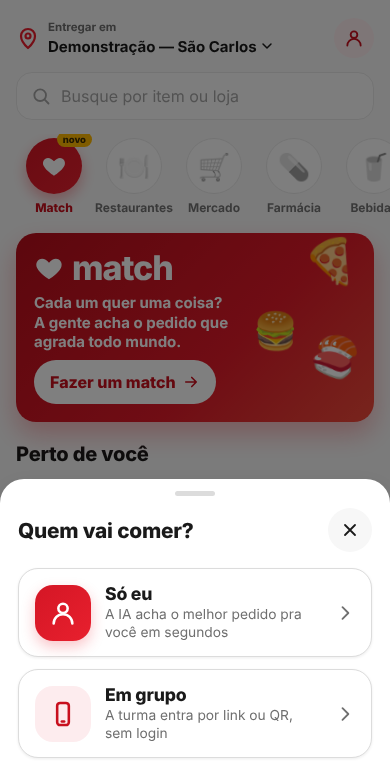<figcaption><b>2 · Quem vai comer?</b> Folha inferior com duas portas: <i>Só eu</i> (a IA acha o pedido em segundos) ou <i>Em grupo</i> (a turma entra por link ou QR, sem login).</figcaption></figure>
<figure><figcaption><b>3 · Sala do organizador.</b> QR e link com o IP da rede (os celulares abrem direto); lista "quem entrou" com status em palavra; "3 de 3 convidados responderam"; botão Rodar Match fixo no pé.</figcaption></figure>
<figure>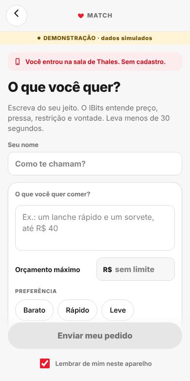<figcaption><b>4 · Convidado.</b> Sem cadastro: nome, uma frase do seu jeito, orçamento opcional e chips de preferência e restrição, com aviso honesto sobre alergias.</figcaption></figure>
<figure>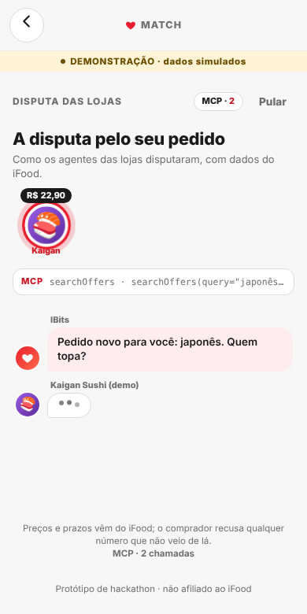<figcaption><b>5 · Como o IBits avaliou cada loja.</b> Um avaliador por loja, que só lê o cardápio dela; preço e prazo vêm do MCP; contador de chamadas ao MCP; botão Pular.</figcaption></figure>
<figure>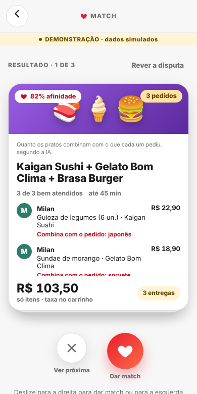<figcaption><b>6 · Opções.</b> Um cartão por combinação: lojas, item de cada pessoa com o motivo, total só de itens ("taxa no carrinho"), número de entregas; afinidade explicada em uma linha. Deslizar ou usar os botões.</figcaption></figure>
<figure>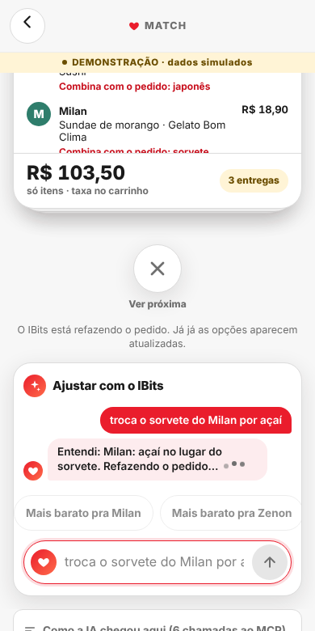<figcaption><b>7 · Ajustar com o IBits.</b> Conversa depois do resultado: "troca o sorvete do Milan por açaí" → "Entendi: Milan: açaí no lugar do sorvete. Refazendo o pedido…". Sugestões geradas a partir de quem respondeu.</figcaption></figure>
<figure>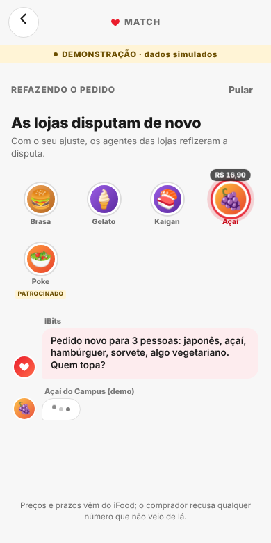<figcaption><b>8 · Opções atualizadas.</b> O Match roda de novo só com a mudança; o cartão ganha o selo "Atualizado" e o item novo, "NOVO". Os convidados veem "O organizador ajustou o pedido".</figcaption></figure>
<figure>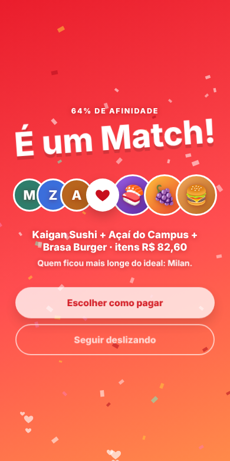<figcaption><b>9 · É um Match!</b> Celebração com a afinidade do grupo, as pessoas e as lojas, e quem ficou mais longe do ideal (honestidade).</figcaption></figure>
<figure>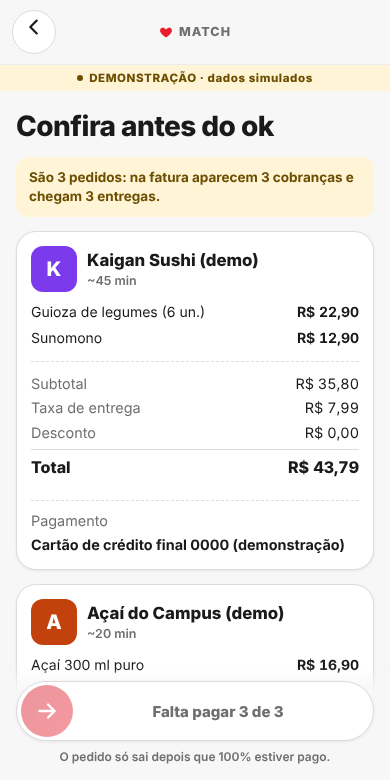<figcaption><b>10 · Confira antes do ok.</b> "São 3 pedidos: 3 cobranças e 3 entregas"; carrinho por loja com subtotal, taxa e total lidos do carrinho; forma de pagamento de cada carrinho.</figcaption></figure>
<figure>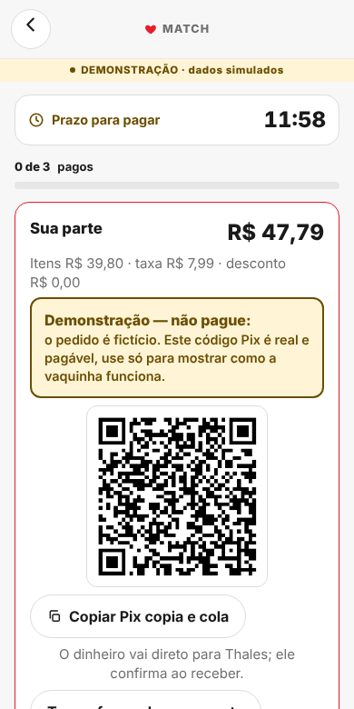<figcaption><b>11 · Vaquinha.</b> Cada um paga a sua parte (taxa dividida só entre quem pediu da loja); Pix direto para o organizador com aviso "Demonstração — não pague"; prazo visível; o pedido só sai com 100% pago.</figcaption></figure>
<figure>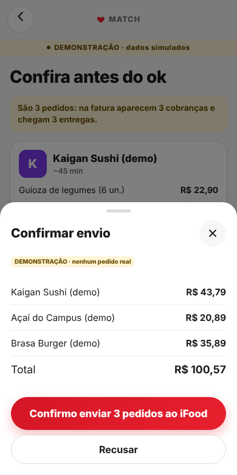<figcaption><b>12 · Confirmar envio.</b> "Deslize para enviar" (com alternativa por botão) abre a folha de resumo; nada é enviado sem "Confirmo enviar".</figcaption></figure>
<figure>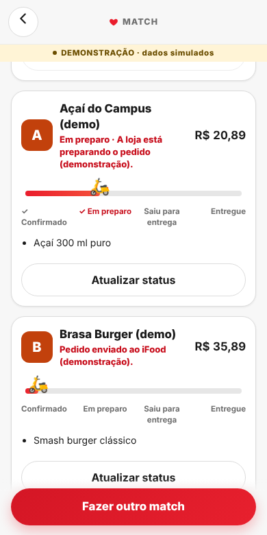<figcaption><b>13 · Pedidos.</b> Um cartão por loja com a linha do tempo do acompanhamento (confirmado → em preparo → saiu → entregue), vinda do <code>trackOrder</code>.</figcaption></figure>

### Só eu

<figure>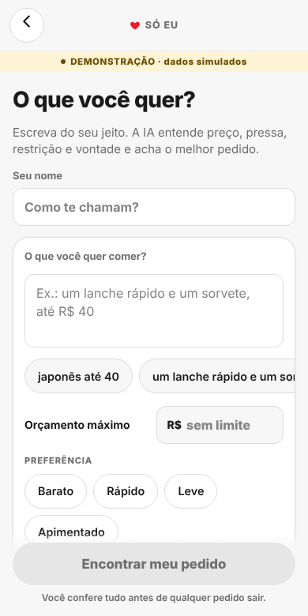<figcaption><b>14 · Só eu.</b> Uma tela: "O que você quer?" com exemplos para tocar, orçamento e chips; "Encontrar meu pedido".</figcaption></figure>
<figure>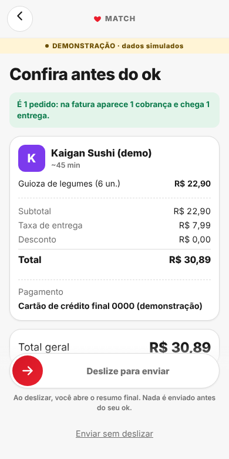<figcaption><b>15 · Só eu: confira.</b> Sem vaquinha nem QR: "É 1 pedido: 1 cobrança e 1 entrega", carrinho e "Deslize para enviar".</figcaption></figure>

