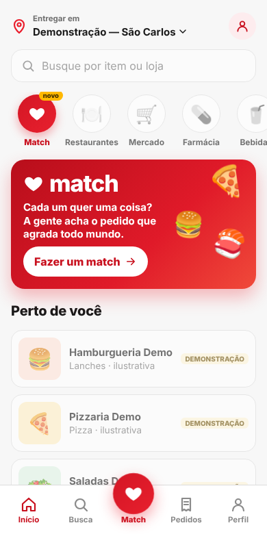
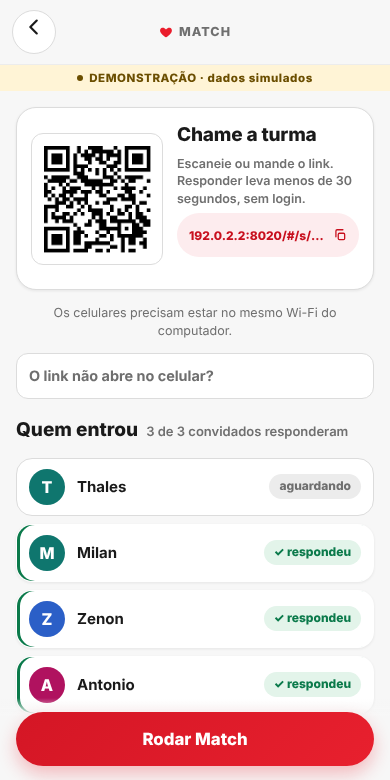
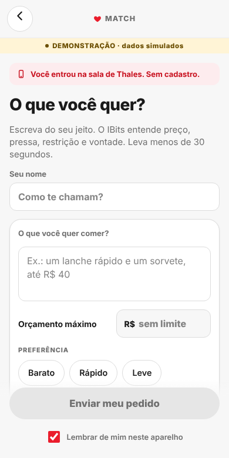
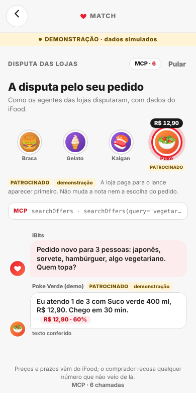
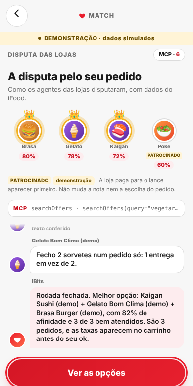
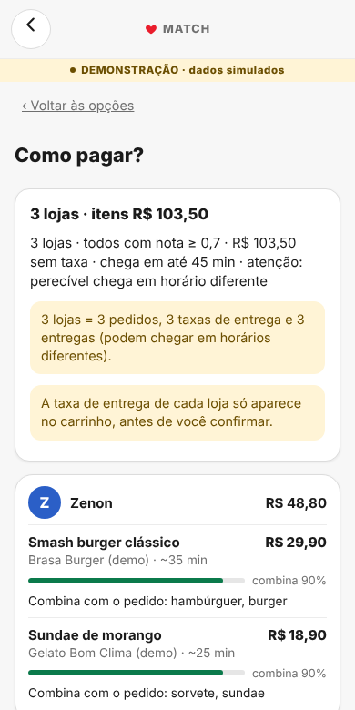
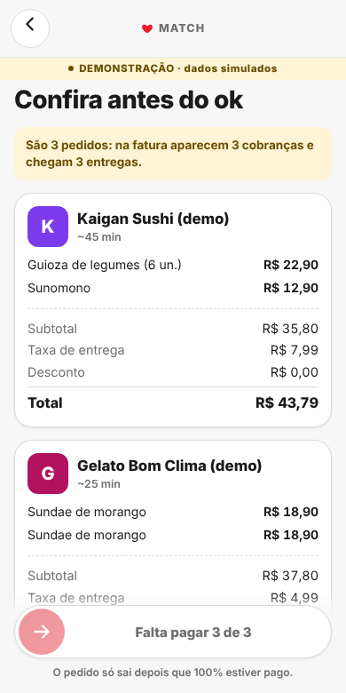

# Interface visual — Match

> Capturas reais do protótipo rodando no modo demonstração (celular, 390 × 780). Os dados das lojas são simulados
> e aparecem com o selo **DEMONSTRAÇÃO**. Imagens em `pitch/img/`. Racional de cada escolha: entregável 03.

## Linguagem visual

- **Alinhada ao app do iFood, sem se passar por ele:** vermelho `#EA1D2C` (único hex confirmado em fonte do iFood),
  fundo claro, cartões brancos com cantos arredondados, home com "Entregar em", verticais e cards de loja.
- **Sem logo, sem fonte proprietária, sem fotos do iFood:** fonte Inter, emoji neutros por categoria, wordmark próprio
  "match". Rodapé fixo: "Protótipo de hackathon · não afiliado ao iFood".
- **Mobile first:** convidados respondem pelo celular; o organizador pode usar o PC (QR grande na tela).

| Token | Valor | Origem |
|---|---|---|
| Marca | `#EA1D2C` | confirmado (blog técnico do iFood) |
| Marca escura (texto pequeno em vermelho) | `#C8101E` | não oficial, escolhido por contraste 5,9:1 |
| Texto / texto suave | `#1A1A1A` / `#6F6F6F` | nosso |
| Fundo / cartão | `#F7F7F7` / `#FFFFFF` | nosso |
| Raios | 8 · 12 · 16 · pílula | nosso |
| Fonte | Inter, system-ui | livre |

Detalhes e fontes: `docs/design-ifood.md` §5 e `docs/racional-ux.md` §6–7.

## Telas

<figure><figcaption><b>1 · Início.</b> Home no padrão do app: "Entregar em", busca, verticais com <i>Match</i> (selo "novo"), banner "Fazer um match" e aba central Match.</figcaption></figure>
<figure><figcaption><b>2 · Sala do organizador.</b> QR e link para chamar a turma, sem login; lista "quem entrou" com status; botão "Rodar Match".</figcaption></figure>
<figure><figcaption><b>3 · Convidado.</b> Entra pelo link, escreve o que quer numa frase, orçamento opcional e chips de preferência (barato, rápido, leve).</figcaption></figure>
<figure><figcaption><b>4 · Disputa das lojas.</b> Agentes vendedores fazem lances com preço vindo do MCP; selo PATROCINADO não muda a nota; contador de chamadas MCP.</figcaption></figure>
<figure><figcaption><b>5 · Fim da rodada.</b> Coroas nas lojas escolhidas e afinidade por loja; o IBits (agente comprador) explica a melhor combinação e avisa as taxas.</figcaption></figure>
<figure><figcaption><b>6 · É um Match!</b> Celebração com a afinidade do grupo, as pessoas e as lojas da combinação.</figcaption></figure>
<figure><figcaption><b>7 · Opção escolhida.</b> Resumo (3 lojas = 3 pedidos, 3 taxas, 3 entregas), item por pessoa com o motivo e a nota de combinação.</figcaption></figure>
<figure><figcaption><b>8 · Confira antes do ok.</b> Carrinho por loja com subtotal, taxa e total do iFood; o pedido só sai com 100% pago e consentimento.</figcaption></figure>

