# Interface visual — Match

> Capturas reais do protótipo (celular, 390 × 780). As telas 1 a 19 são do modo demonstração, com o fluxo completo
> passando pela interface (`docs/entrega/capturar_telas.sh` regera todas); os dados das lojas são simulados e aparecem
> com o selo **DEMONSTRAÇÃO**. As telas "No iFood de verdade" são do app ligado ao MCP real do iFood, com uma conta de
> teste: lojas, logos, fotos, preços e carrinhos vêm do iFood. Imagens em `docs/entrega/telas/`. Racional de cada
> escolha: entregável 03.

## Linguagem visual

- **Alinhada ao app do iFood, sem se passar por ele:** vermelho `#EA1D2C` (único hex confirmado em fonte do iFood),
  fundo claro, cartões brancos com cantos arredondados, home com "Entregar em", verticais e cards de loja.
- **Marca própria:** wordmark "match" no topo de cada tela, fonte Inter, ícones de traço e avatar com a inicial de cada
  pessoa. Fotos dos pratos e logos das lojas só quando vêm do MCP (endereços `static.ifood-static.com.br`); sem foto,
  fica sem foto. Rodapé fixo: "Protótipo de hackathon · não afiliado ao iFood".
- **Faixa de modo sempre visível:** amarela "DEMONSTRAÇÃO · dados simulados" ou azul "iFood real · conta de teste".
- **Mobile first:** convidados respondem pelo celular; o organizador pode usar o PC (QR grande na tela).

| Token | Valor | Origem |
|---|---|---|
| Marca | `#EA1D2C` | confirmado (blog técnico do iFood) |
| Marca escura (texto pequeno em vermelho) | `#C8101E` | não oficial, escolhido por contraste 5,9:1 |
| Texto / texto suave | `#1A1A1A` / `#6F6F6F` | nosso |
| Fundo / cartão | `#F7F7F7` / `#FFFFFF` | nosso |
| Raios | 8 · 12 · 16 · pílula | nosso |
| Fonte | Inter, system-ui | livre |

Detalhes e fontes: `docs/design-ifood.md` §5 e `docs/racional-ux.md` §6–7.

## Telas

### Em grupo

<figure><figcaption><b>1 · Início.</b> Home no padrão do app: "Entregar em", busca, verticais com <i>Match</i> (selo "novo"), banner "Fazer um match" e aba central Match. Itens fora do protótipo avisam em vez de parecer quebrados.</figcaption></figure>
<figure><figcaption><b>2 · Quem vai comer?.</b> Folha inferior com duas portas: <i>Só eu</i> (comida ou compras de mercado, farmácia e pet; a IA monta o pedido em segundos) ou <i>Em grupo</i> (a turma entra por link ou QR, sem login).</figcaption></figure>
<figure><figcaption><b>3 · Sala do organizador.</b> QR e link com o IP da rede (os celulares abrem direto); lista "Quem entrou" com status em palavra; "3 de 3 convidados responderam"; botão Rodar Match fixo no pé.</figcaption></figure>
<figure><figcaption><b>4 · Convidado.</b> Sem cadastro: nome, uma frase do seu jeito, orçamento opcional e a fileira "É comida ou compras?". Mercado, farmácia e pet só entram com "Compras": a IA não precisa adivinhar.</figcaption></figure>
<figure><figcaption><b>5 · Como o Match avaliou cada loja.</b> Um avaliador por loja, que só lê o cardápio dela; preço e prazo vêm do MCP; contador de chamadas ao MCP; botão Pular e, no fim, "Ver o pedido".</figcaption></figure>
<figure>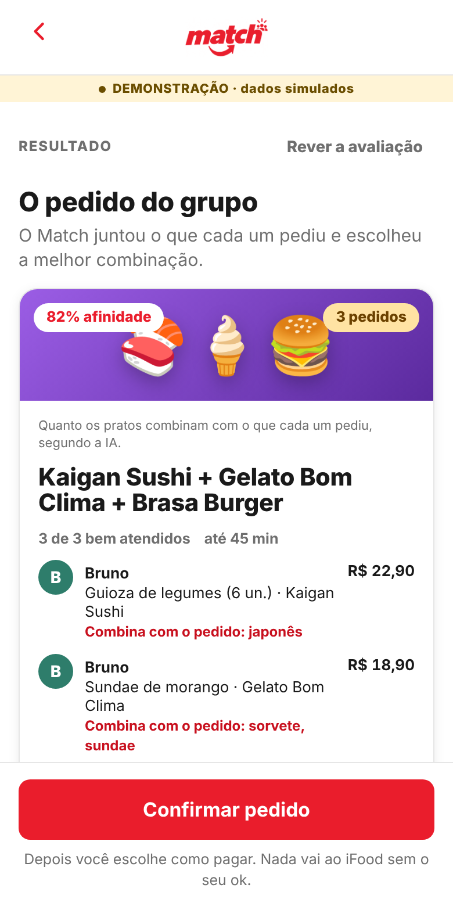<figcaption><b>6 · O pedido do grupo.</b> O Match já escolheu a melhor combinação: lojas, item de cada pessoa com o motivo, total só de itens, número de entregas e afinidade em uma linha. Mudar = "Ajustar com o Match"; "Confirmar pedido" fica fixo embaixo. O convidado vê só a parte dele.</figcaption></figure>
<figure><figcaption><b>7 · Ajustar com o Match.</b> Conversa depois do resultado: "troca o sorvete de Bruno por açaí" → "Entendi: Bruno: açaí no lugar do sorvete. Pronto, atualizei o pedido.". Sugestões geradas a partir de quem respondeu.</figcaption></figure>
<figure><figcaption><b>8 · Pedido atualizado.</b> O Match roda de novo só com a mudança; o cartão ganha o selo "Atualizado" e o item novo, "NOVO". Os convidados veem que o organizador ajustou o pedido.</figcaption></figure>
<figure>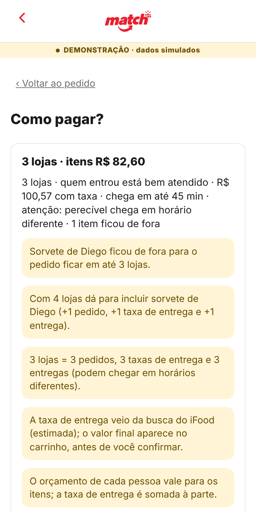<figcaption><b>9 · Como pagar?.</b> Resumo com os avisos honestos (o item que ficou de fora para caber em 3 lojas, 3 lojas = 3 taxas e 3 entregas, taxa estimada pela busca) e a escolha entre pagamento único e vaquinha.</figcaption></figure>
<figure><figcaption><b>10 · Confira antes do ok.</b> "São 3 pedidos: na fatura aparecem 3 cobranças e chegam 3 entregas"; carrinho por loja com subtotal, taxa, desconto e total lidos do carrinho; forma de pagamento de cada carrinho.</figcaption></figure>
<figure><figcaption><b>11 · Vaquinha.</b> Cada um paga a sua parte (taxa dividida só entre quem pediu da loja); Pix direto para o organizador com aviso "Demonstração — não pague"; prazo visível; o pedido só sai com 100% pago.</figcaption></figure>
<figure><figcaption><b>12 · Confirmar envio.</b> "Deslize para enviar" (com a alternativa "Enviar sem deslizar") abre a folha de resumo; nada é enviado sem "Confirmo enviar 3 pedidos ao iFood".</figcaption></figure>
<figure><figcaption><b>13 · Pedidos enviados.</b> Um cartão por loja com a linha do tempo do acompanhamento (confirmado → em preparo → saiu → entregue), vinda do <code>trackOrder</code>.</figcaption></figure>

### Só eu (comida ou compras)

<figure><figcaption><b>14 · Só eu.</b> Uma tela: "O que você quer?" com exemplos para tocar, orçamento e "É comida ou compras?"; "Encontrar meu pedido".</figcaption></figure>
<figure>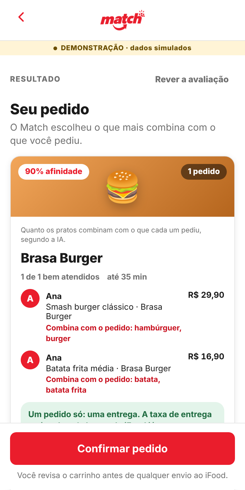<figcaption><b>15 · Seu pedido.</b> "hambúrguer e uma batata frita": os dois itens saem da mesma loja, uma entrega só (regra "mesma loja" do <code>regras_pedido.json</code>).</figcaption></figure>
<figure>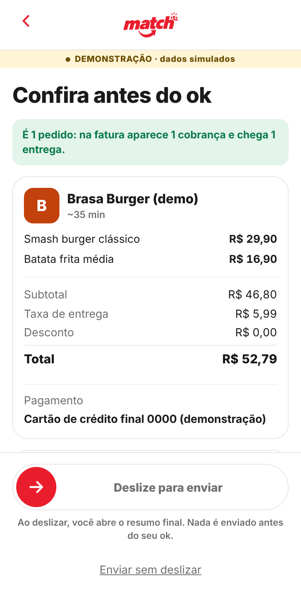<figcaption><b>16 · Só eu: confira.</b> Sem vaquinha nem QR: "É 1 pedido: 1 cobrança e 1 entrega", carrinho e "Deslize para enviar".</figcaption></figure>
<figure>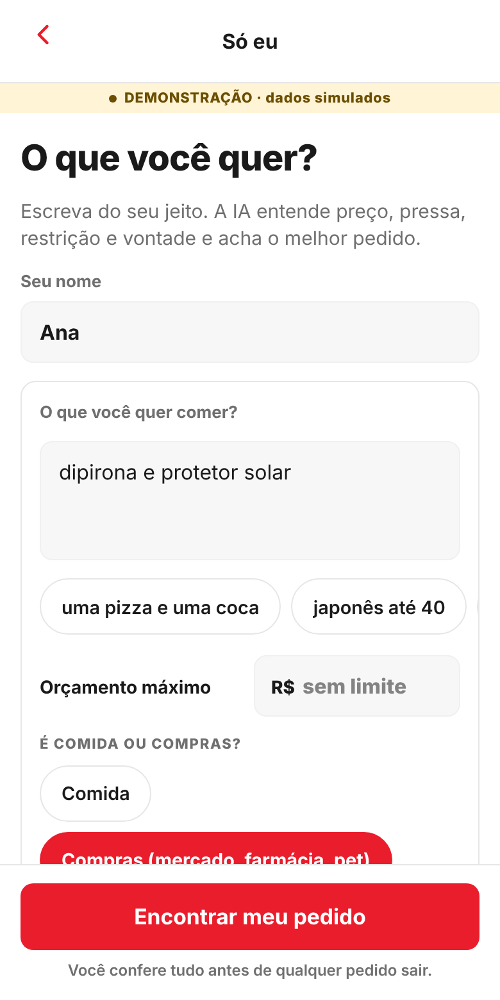<figcaption><b>17 · Compras ligado.</b> Com "Compras", a mesma tela aceita farmácia, mercado e pet: "dipirona e protetor solar".</figcaption></figure>
<figure>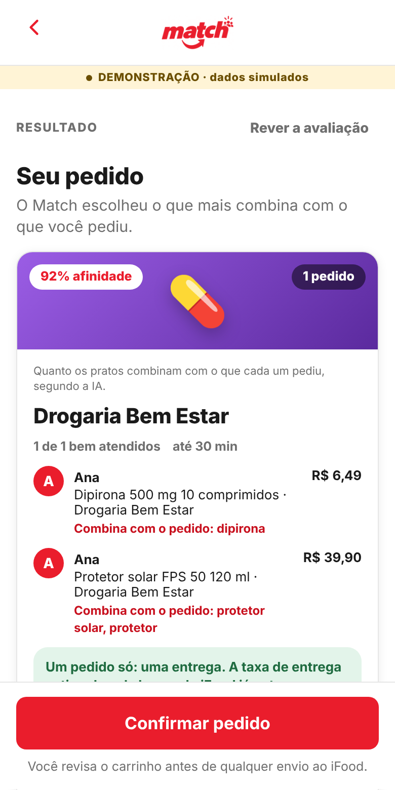<figcaption><b>18 · Farmácia.</b> O Match acha os dois itens na mesma farmácia.</figcaption></figure>
<figure>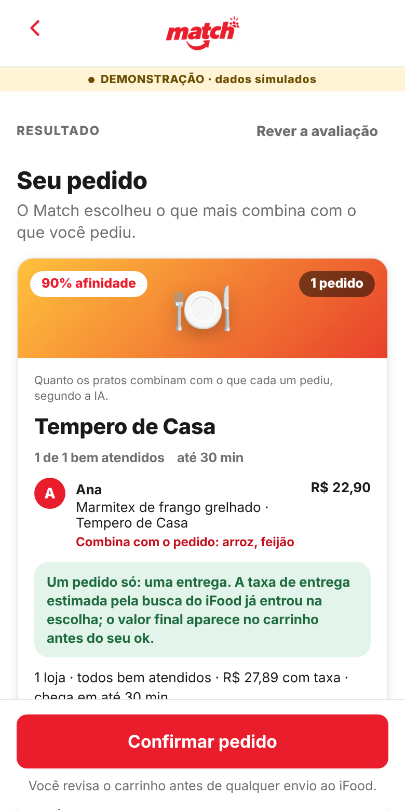<figcaption><b>19 · Sem Compras.</b> "arroz, feijão e bife" sem o botão vira prato de restaurante (marmita), nunca lista de mercado.</figcaption></figure>

### No iFood de verdade (MCP real, conta de teste)

<figure>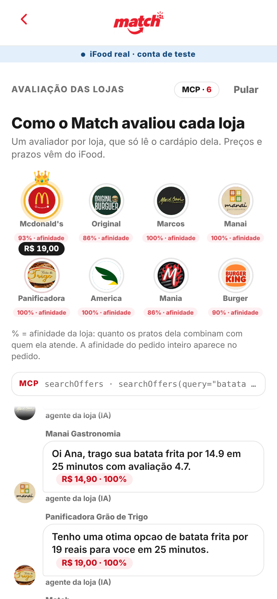<figcaption><b>A · Avaliação real.</b> Lojas reais com os logos do iFood, afinidade de cada uma e as ofertas que os avaliadores encontraram no <code>searchOffers</code>.</figcaption></figure>
<figure>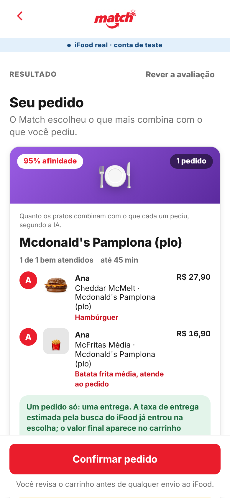<figcaption><b>B · Pedido real.</b> Hambúrguer + McFritas no mesmo McDonald’s, com as fotos do iFood.</figcaption></figure>
<figure>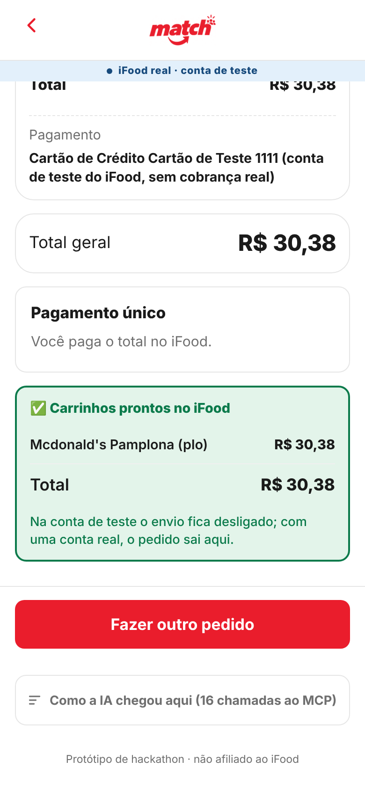<figcaption><b>C · Carrinhos prontos.</b> <code>createCart</code> + <code>getCart</code> reais: total lido do iFood. Na conta de teste o envio fica desligado.</figcaption></figure>
<figure>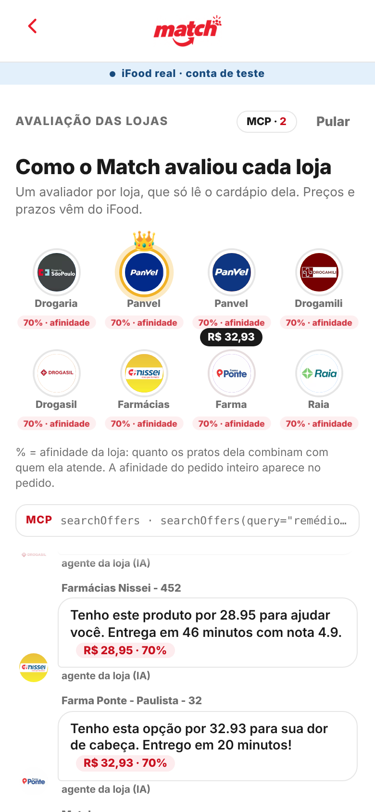<figcaption><b>D · Remédio, só eu.</b> "remédio para dor de cabeça" com Compras: o Match avalia as farmácias reais perto do endereço.</figcaption></figure>
<figure>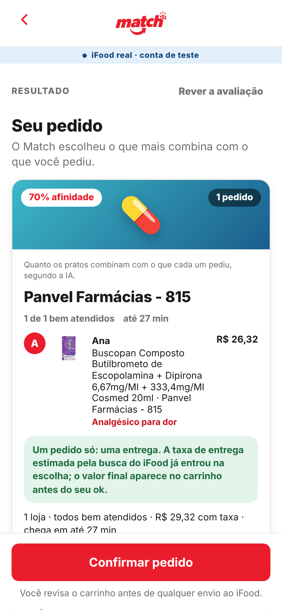<figcaption><b>E · Remédio: pedido.</b> Um analgésico sem receita numa farmácia real, com prazo e total vindos do iFood.</figcaption></figure>

