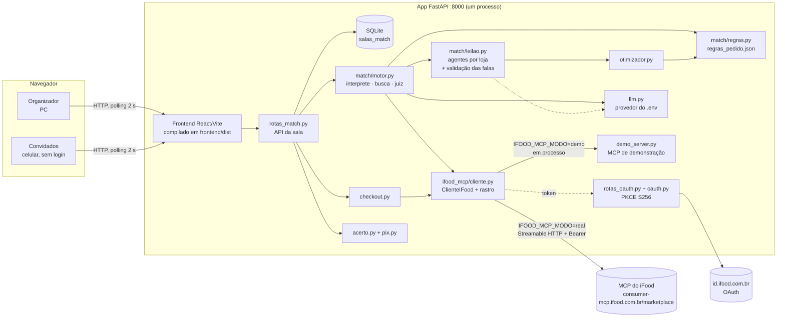
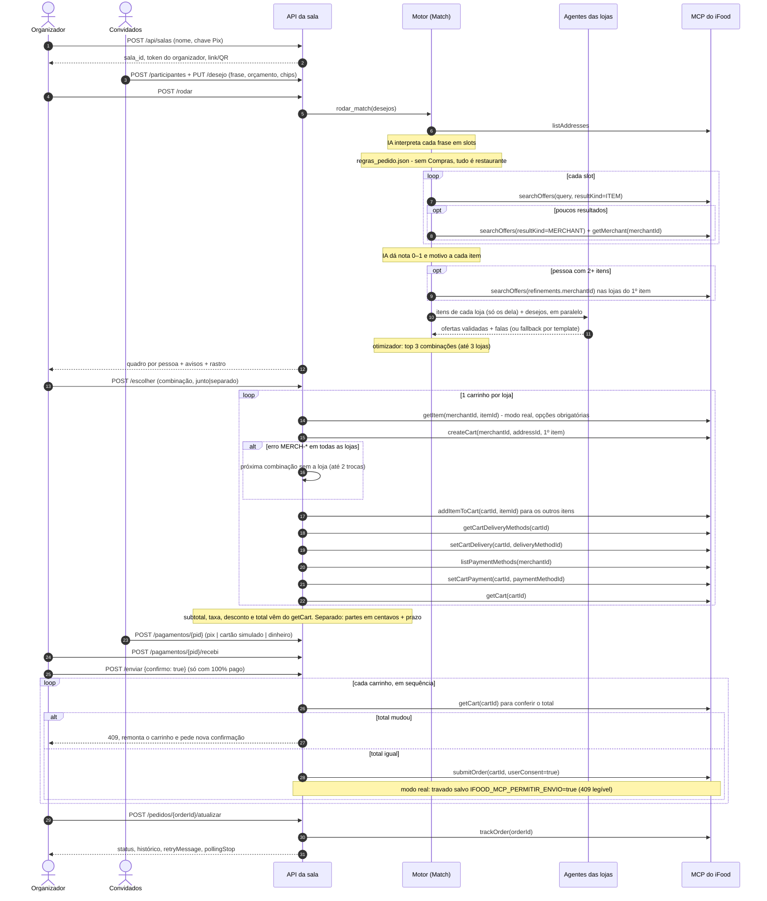
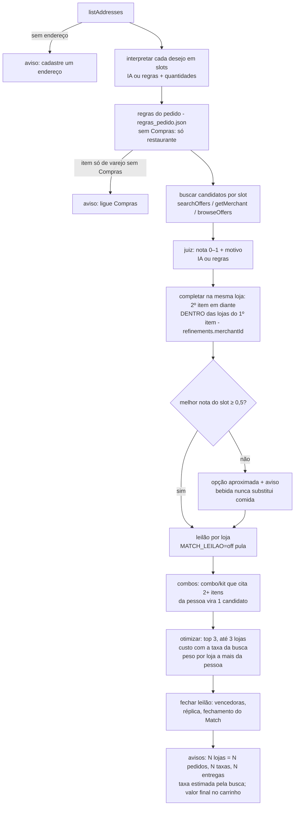
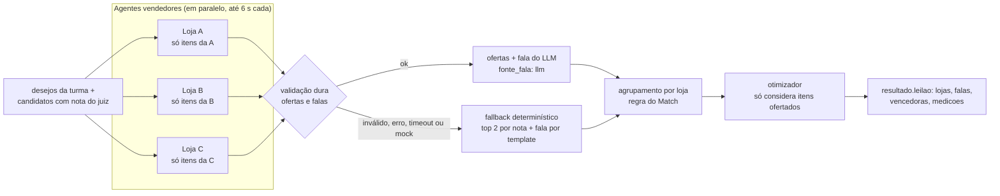
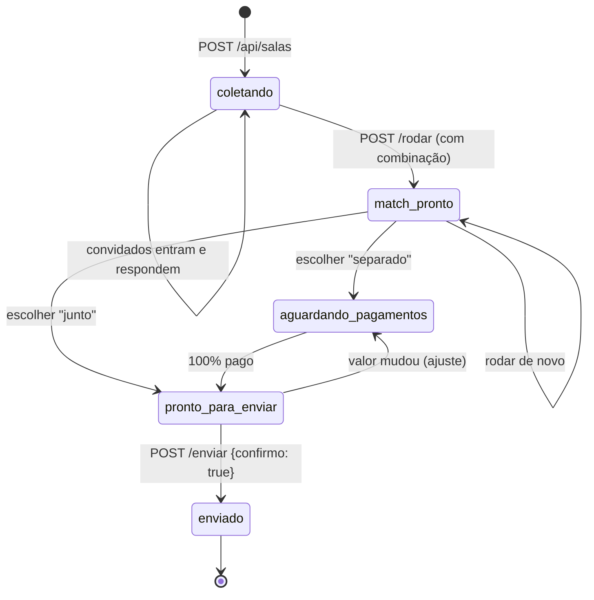

# Match — desenho de solução e documentação técnica

> Entregáveis 2 (desenho de solução) e 5 (documentação técnica) do Hackathon SEMCOMP × iFood 2026.
> Protótipo de hackathon, não afiliado ao iFood. Como rodar: [`README.md`](../README.md).
> Estado do código em 18/10/2026 (manhã).

## 1. Visão geral

O Match transforma frases livres de 1 ou N pessoas em um pedido viável no iFood: itens reais, preço real, loja(s)
real(is), custo total e motivo de cada escolha. Só o organizador entra no iFood; os convidados entram por link/QR,
sem login.

Divisão de trabalho entre IA e código (decisão central do projeto):

| Quem | Faz |
|---|---|
| IA (LLM, saída JSON) | entende a frase (slots, restrições, orçamento, perfil); dá nota 0–1 e motivo a cada item; o agente de cada loja escolhe o que oferecer a quem e escreve a fala |
| Código determinístico | aplica as regras do pedido (`regras_pedido.json`: botão "Compras", mesma loja); filtra restrições e orçamento; valida cada oferta e cada fala dos agentes (fallback por template); decide o agrupamento por loja; enumera e pontua combinações; divide a conta em centavos; gera o Pix; segue a ordem do checkout; exige consentimento |
| MCP do iFood | **única fonte** de preço, taxa, prazo, disponibilidade, carrinho e pedido |

Toda chamada de IA tem um caminho determinístico de reserva. Com `LLM_PROVIDER=mock` a demo inteira roda sem chave
e sem internet.

**Provedor de IA:** vem do `.env` (`LLM_PROVIDER`, `LLM_MODEL`, `LLM_MODELOS_RESERVA`), sem mudar código
(`match/llm.py`, `config.py`). Na demo usamos **Gemini** pelo endpoint compatível com OpenAI
(`generativelanguage.googleapis.com/v1beta/openai/`), modelo principal `gemini-3.5-flash-lite` e reserva
`gemini-3.5-flash`, porque o limite diário do Groq estourou. No teste no MCP real (18/10 08h59): 0 falha de IA,
13–24 s por Match. Se o modelo dá 429, entra o de reserva; se tudo falha, o fallback offline segue.

## 2. Componentes



| Componente | Arquivo | Papel |
|---|---|---|
| Frontend | `frontend/src/` | React 19 + TypeScript (Vite). Rotas por hash: `#/` (início estilo app), `#/s/{id}` (convidado), `#/s/{id}/org` (organizador), `#/conectado` (volta do login). Polling de 2 s em `GET /api/salas/{id}`. Compilado e servido pelo próprio FastAPI (uma URL na demo). Telas do Match: `telas/Leilao.tsx` (disputa) e `telas/Deck.tsx` (o pedido escolhido pelo Match), com peças em `componentes/leilao/` (seção 5). `telas/SoEu.tsx` (pedido de 1 pessoa) e `telas/Convidado.tsx` têm a fileira "É comida ou compras?" (Comida · Compras = chip `modo:compras`). Foto do item e logo da loja só quando vêm do MCP (`imagem_url`/`loja_logo_url`). |
| API da sala | `backend/app/rotas_match.py` | Criar sala, entrar, desejo, rodar, escolher, pagar, enviar, acompanhar. Ações do organizador exigem o header `X-Organizador`. |
| Sala | `backend/app/match/salas.py` | Estado inteiro da sala em JSON numa tabela SQLite própria. Escrita atômica (trava + transação). Chamadas ao MCP ficam fora da trava de gravação e o estado é revalidado depois. |
| Motor | `match/motor.py` | `listAddresses` → interpretar (+ quantidades) → **regras do pedido** → buscar → julgar → **completar na mesma loja** (`_completar_na_mesma_loja`) → leilão → otimizar → fechar o leilão → avisos. Loja marcada como indisponível na sala (`lojas_indisponiveis`) fica de fora, com aviso. `MATCH_LEILAO=off` no `.env` pula o leilão (o otimizador volta a ver todos os candidatos). |
| Regras do pedido | `match/regras.py` + `match/regras_pedido.json` | Regras num arquivo, ajustáveis sem mexer no código (seção 4). **Compras:** mercado, farmácia, pet shop e adega só com o chip `modo:compras`; sem ele, todo item vai para `RESTAURANT` e item só de varejo sai com aviso. **Mesma loja:** `peso_por_loja_a_mais_da_pessoa` (0,25) e `lojas_mais_baratas_na_busca_da_loja` (2). |
| Intérprete | `match/interprete.py` | Frase → 1 ou mais **slots** ("japonês e um sorvete" = 2 slots). IA com validação; reserva por palavras-chave + chips. **Consulta livre sem IA:** item fora das categorias conhecidas ("coxinha", "feijoada completa") vira consulta pelo próprio texto (até 4 palavras, sem orçamento, restrição nem palavras genéricas; "coxinha ou esfiha" = alternativas do mesmo slot). **Quantidades:** "2 sorvetes"/"duas coxinhas" viram slots iguais (até 3 iguais e 4 slots por pessoa; "pizza 4 queijos" não é quantidade); o que não couber vira aviso, nunca some calado. **Refeição:** "marmita", "PF", "prato feito", "executivo" ou "arroz, feijão, salada e guarnição" viram 1 item de restaurante (consultas `marmita`/`prato feito`/`executivo`), não lista de mercado. |
| Busca | `match/busca.py` | Único arquivo que lê campos das tools de descoberta. Preço só da tool; item sem preço é descartado. ≤ 8 candidatos por slot, diversificados por loja. **Leitura robusta de endereço:** acha a lista do `listAddresses` em formatos variados (raiz lista, `addresses`, `data.addresses`…), prefere o último usado/padrão e lê coordenadas com nomes alternativos (`lat`/`lng`/`lon`). Lê a foto do item (`itemImageUrl`) e a logo da loja (`merchantLogoUrl`) só se a URL começar com `https://static.ifood-static.com.br/`. `buscar_na_loja`: `searchOffers` com `refinements.merchantId`. |
| Juiz | `match/juiz.py` | Nota 0–1 + motivo curto. Restrição sem tag no item não elimina: o motivo avisa "confirme com a loja". Bebida reconhecida também pelo **nome** do item (`_nome_de_bebida`: "Coca-Cola Original 350ml"; combo com "+" não conta), porque o item achado na busca da loja vem sem categoria: bebida nunca vira "opção aproximada" de comida. |
| Leilão | `match/leilao.py` + `match/politica_lojas.json` | 1 agente vendedor por loja, validação dura das ofertas e falas, fallback por template, medições (seção 5). |
| Otimizador | `match/otimizador.py` | Código puro, sem I/O nem IA (seção 6). |
| Checkout | `match/checkout.py` | Único arquivo que lê campos de carrinho/pedido. 1 carrinho por loja, envio com consentimento, `trackOrder`. No modo real, 1 `getItem` por item escolhido (opções obrigatórias) e `createCart` já com o 1º item. **Desconto do `getCart`:** lido do `summary` (`benefitsTotalAmount` e outros nomes aceitos); se não vem e o total é menor que subtotal + taxas, é derivado do total; se não fecha (frete grátis contado 2 vezes, bug 39), vale o total do iFood. **Loja indisponível:** erro `MERCH-*` (ex.: `MERCH-007`) → `loja_indisponivel()` → mensagem em português, sem o id. |
| Acerto e Pix | `match/acerto.py`, `match/pix.py` | Partes por pessoa em centavos; Pix copia e cola (BR Code estático). |
| Cliente MCP | `ifood_mcp/cliente.py` | Mesma interface nos dois modos; registra cada chamada no **rastro** (tool, resumo sem dados sensíveis, ms, ok/erro). No modo real lê o `input_schema` de cada tool (1 `list_tools` por sessão) e adapta os argumentos: `latitude`/`longitude` viram `userLocation: {latitude, longitude}` quando a tool declara esse campo, `query` vira o campo de texto declarado (`term`, `q`…) e argumentos não declarados são descartados; o rastro mostra o que foi descartado ("descartados: latitude, longitude"). **Trava de envio:** no modo real, `submitOrder` só é chamado com `IFOOD_MCP_PERMITIR_ENVIO=true` (seção 9). |
| MCP de demonstração | `ifood_mcp/demo_server.py` | Servidor MCP (SDK `mcp` 2.x) com 17 tools de **mesmo nome e campos** da doc oficial; lojas fictícias; todo payload com `"demonstracao": true`. |
| OAuth | `ifood_mcp/oauth.py`, `rotas_oauth.py` | Authorization Code + PKCE S256 + client secret; tokens em arquivo fora do git; renovação automática. |
| Diagnóstico | `ifood_mcp/diagnostico.py` | Roda no PC da equipe: `list_tools` + chamadas de leitura → amostras **sanitizadas** em `docs/mcp-real/`. Nunca chama `submitOrder`. |

## 3. Sequência completa de um Match em grupo

Ordem obrigatória da documentação do MCP: `listAddresses` → `searchOffers` → `getMerchant` → `getItem` →
`createCart` → `addItemToCart` → `getCartDeliveryMethods` → `setCartDelivery` → `listPaymentMethods` →
`setCartPayment` → `getCart` → `submitOrder({cartId, userConsent: true})` → `trackOrder`.



Cada seta para o MCP vira uma linha do rastro na tela, com o nome da tool da documentação. O resumo do rastro não
mostra latitude, longitude, endereço, e-mail, telefone nem CPF.

## 4. Fluxo do motor



**Pedido completo** (etapa 05, Trilha A′): cada pessoa pode pedir até 4 itens ("uma pizza e uma coca", "hambúrguer
com batata e refri"). (1) Bebida pela marca ("coca", "guaraná") também busca "refrigerante". (2) O 2º item em diante
é procurado também **dentro das lojas do 1º item** (`_completar_na_mesma_loja`, depois do juiz): as 3 de melhor nota
e preço do 1º item mais as 2 mais baratas dele (`regras_pedido.json`), com `searchOffers` + `refinements.merchantId` —
o caminho que o próprio `getMerchant` real indica em `catalogSummary.navigationHint`; assim o refri vem da pizzaria
da pizza, não de outra loja (+1 taxa, +1 entrega). No MCP real, "um hambúrguer e uma batata frita" saía Big Mac +
batata de outra loja; com as mais baratas, saem Big Mac + McFritas no McDonald's (bug 41). (3) Um combo/kit da loja
que cita 2+ itens da pessoa vira um candidato só (`Candidato.cobre`), que o otimizador compara com os itens avulsos — nunca os dois juntos
(`Combinacao.cobertos` diz quais itens o combo atende). (4) A taxa de entrega e o pedido mínimo vêm do
`merchant{}` de cada resultado do `searchOffers` e entram no custo; quando juntar itens reduz lojas, a tela diz quanto
o pedido paga a menos de taxa do que se cada item viesse da loja com a melhor nota.

**Regras do pedido** (`regras.py` + `regras_pedido.json`, aplicadas logo depois do intérprete):
- **Botão "Compras"** (chip `modo:compras`). Sem ele, todo item vai para restaurante: "arroz, feijão e bife" vira
  prato/marmita. Item que só existe em loja de compras sai com o aviso "Dipirona para Ana é de farmácia: ligue
  "Compras" para pedir em mercado, farmácia ou pet shop."; se ninguém fica com item, a API devolve 409 com esse aviso.
- **Mesma loja.** No otimizador, cada loja a mais nos itens de uma mesma pessoa tira 0,25 do score (a nota de um item
  vai de 0 a 1). No grupo, a batata da Ana não vai mais para a loja da Bia só por ser um pouco mais barata.
- Testes: `tests/test_regras_pedido.py`.

**Só eu além de restaurante** (com "Compras"): lista de compras de mercado, farmácia, pet shop ou adega ("preciso
fazer compras: arroz, feijão e detergente", "dipirona e protetor solar") vira 1 item por produto, cada um buscado com
o `merchantType` da categoria. O lugar ("fazer compras", "na farmácia") não vira item; item sem categoria segue o
anterior; no varejo, produto diferente não ganha por ser mais barato (só concorrem itens perto da melhor nota) e não
há "opção aproximada". Lojas diferentes continuam sendo carrinhos e entregas diferentes: o Match não junta entregas.
No MCP real, "um remédio para dor de cabeça" (Só eu + Compras) encontrou 8 farmácias reais, com preço e prazo do
iFood (caso mostrado no pitch).

Regras de relevância já no código: item com nota < 0,25 sai se houver opção melhor; slot cujo melhor item fica
abaixo de 0,5 vira "Opção aproximada: …" com aviso "Não achei X; a opção mais próxima é Y"; se ninguém tem item
relevante, não há combinação e a API devolve 409 com a pergunta "Quer mudar o pedido?".

## 5. Leilão de agentes por loja

Contratos C11 e C12 de [`docs/planos/etapa-04-leilao-e-entrega.md`](planos/etapa-04-leilao-e-entrega.md).
Decisões 9 e 10 de [`docs/decisions.md`](decisions.md). Código: `match/leilao.py` (chamado pelo `motor.py`).

Ideia: o tema é "Vendendo com Agentes". Cada restaurante tem um **agente vendedor** que só enxerga o próprio
cardápio (vindo do MCP) e disputa o pedido; o **Match**, agente comprador do grupo, decide entre os lances.



Quem decide o quê:
- **Agente da loja (LLM):** o que oferecer a quem (até 2 itens por slot, entre os candidatos válidos da própria
  loja), se passa a vez, e **como dizer** (fala e réplica). Saída JSON:
  `{"ofertas": [{"slot_id", "item_id", "motivo"}], "passo": bool, "fala": str, "replica": str}`.
- **Regra do Match (código):** agrupar no mesmo pedido os itens de uma loja que atende 2 ou mais pessoas ("1
  entrega em vez de 2"). A decisão é do código; só o texto da réplica pode vir do agente, se passar na validação.
- **Match, o comprador (código):** abertura, fechamento, vencedoras (lojas da 1ª combinação do otimizador) e a frase "a melhor
  da sala", calculada só quando uma loja tem a maior avaliação sem empate.

Como funciona:
- Entram no leilão até 8 lojas que aparecem nos candidatos: a melhor loja de cada slot (ninguém perde a única opção)
  e o resto por melhor nota do juiz. Um agente por loja com algo válido, em paralelo (`asyncio.gather`), com tempo
  máximo de 6 s cada; loja sem item válido passa sem gastar chamada.
- Entrada do agente: só os itens daquela loja por slot (nome, descrição, categoria, tags, preço do MCP, preço "de"
  se houver promoção, nota do juiz), o texto de cada pessoa, ETA e avaliação da loja. Os textos são tratados como
  dados (o prompt manda ignorar instruções dentro deles).
- **Validação das ofertas:** `slot_id` existe; `item_id` é candidato válido daquela loja naquele slot (sem violar
  restrição nem orçamento); no máximo 2 por slot; motivo ≤ 90 caracteres, sem número e honesto (senão fica o motivo
  do juiz). Oferta inválida é descartada.
- **Validação das falas e da réplica** (≤ 200 caracteres). A fala do LLM é trocada pelo template
  (`fonte_fala: "modelo"`) se tiver:
  - **número** (em algarismo ou **por extenso**, como "dezoito e noventa") fora do conjunto permitido: preços
    ofertados, preço "de" da promoção, ETA, avaliação, contagens, afinidade e números do nome/descrição do item;
  - **contagem** que não bate ("fecho 3 sorvetes" só com 3 sorvetes ofertados; "atendo 3 pessoas" só se atende 3);
  - **"todo mundo"/"todos"** sem atender todas as pessoas;
  - **restrição ou alegação de saúde** (vegano, vegetariano, sem lactose, sem glúten, light, fit, orgânico,
    saudável…) que nenhuma **tag** dos itens ofertados confirma (o nome do próprio item conta como dado do MCP);
  - **promessa** (grátis, frete, taxa, cupom, brinde, cashback; "promoção"/"desconto" só se o item tiver preço "de");
  - **superlativo ou comparativo** ("o melhor", "o mais barato"): o agente não vê as outras lojas.
- **Fallback** (`LLM_PROVIDER=mock`, erro, timeout, JSON inválido ou nenhuma oferta válida sem "passo"): top 2 por
  nota do juiz em cada slot da loja; fala por template a partir dos números. Rede de segurança: um slot que tinha
  opção válida nunca fica sem oferta (se todos os agentes o esqueceram, entra o top 2 por template).
- **Garantia:** com `LLM_PROVIDER=mock` o resultado do roteiro da demo não muda (`test_leilao.py`).
- **Roteiro exibido:** abertura do Match, até 2 passes, até 5 lances (o Patrocinado primeiro, quando houver; o mais
  forte por último; toda vencedora tem o lance mostrado), a réplica da vencedora que agrupa mais pessoas e o
  fechamento do Match ("N de M bem atendidos"; com mais de 1 loja, "São N pedidos, e as taxas aparecem no carrinho
  antes do seu ok"). A taxa de entrega **não** aparece nas falas: ela só existe no carrinho.
- **Medições** no bloco `leilao.medicoes`: `ms_total`, `ms_por_loja` e `chamadas_llm` (só conta resposta JSON
  válida). `leilao.llm` só é `true` se ao menos uma resposta do LLM foi usada. Na tela, cada fala diz a origem:
  "agente da loja (IA)" ou "texto conferido".
- **Desligar:** `MATCH_LEILAO=off` no `.env` volta ao motor sem leilão.

**Patrocinado = só visibilidade.** A loja patrocinada tem o lance **mostrado primeiro** entre os lances e o rótulo
"Patrocinado" (em texto). Não garante vaga entre as lojas consultadas no leilão e **nunca** muda nota, filtro ou
escolha do otimizador. Desligado desde 18/10: hoje nenhuma loja é patrocinada, nem na demo nem no modo real; o
mecanismo segue coberto por `test_leilao.py`. Configuração em `match/politica_lojas.json`.

No front:
- `telas/Leilao.tsx` — "Como o Match avaliou cada loja": falas uma a uma (~0,8 s cada, até 6 na tela; se o roteiro for
  maior, ficam abertura, vencedoras (e patrocinada, quando houver), 1 réplica e o fechamento, sem mudar texto nem
  número), botão **Pular** sempre visível, origem de cada fala e o tempo da avaliação (`medicoes`); no fim, "Ver o
  pedido". No aparelho do organizador a tela não avança sozinha (ele narra); no do convidado avança cerca de 4 s
  depois do fechamento.
- `telas/Deck.tsx` (o nome ficou da versão com deck) — "O pedido do grupo": só a melhor combinação, num cartão sem gesto:
  afinidade, "N de M bem atendidos", lojas e, por pessoa, item · loja · preço · motivo. "Ajustar com o Match" logo
  abaixo; "Confirmar pedido" fixo no rodapé leva a "Como pagar?" (`Resultado.tsx`; com 1 pessoa, monta o carrinho
  direto). O `escolher` continua recebendo o índice da combinação, sempre 0. Convidado vê só a própria parte, em leitura.

## 6. Otimizador

Código puro em `match/otimizador.py`. A IA só fornece a nota de cada item e o perfil de cada pessoa.

```
S(C) = média_p(sat_p) + α·mín_p(sat_p) − β·(custo_total / orçamento_ref) − γ·(atraso_max / 60)
       − δ·(lojas − 1) − ε·penal_perecível − penal_slots_fora − μ·Σ_p(lojas_p − 1)
```

- `sat_p` = média das notas dos slots escolhidos da pessoa `p` (0 se ela ficou de fora).
- **Justiça:** o termo `α·mín` puxa para cima quem ficou pior; ninguém fica com nota baixa para os outros ganharem.
- **Pesos por perfil** (`barato`, `rapido`, `qualidade`, `equilibrado`); com vários perfis no grupo, média campo a
  campo. Padrão: α 0,5 · β 0,3 · γ 0,2 · δ 0,15 · ε 0,3. "Barato" sobe β para 0,9; "rápido" sobe γ para 0,6.
- **Mesma loja:** μ = `peso_por_loja_a_mais_da_pessoa` (0,25 em `regras_pedido.json`); `lojas_p` = lojas diferentes
  nos itens da pessoa `p`. Menos entregas e taxas para a mesma pessoa.
- **Critério antes do score:** atender o máximo de slots; só depois vale o score (custo, lojas e perecível nunca
  "compram" um item cortado).
- **Restrições duras:** item que viola restrição sai; o orçamento da pessoa vale para a **soma** dos slots dela.
- **Slots por pessoa:** o 2º item em diante é opcional (penalidade 0,35 se ficar de fora); o principal paga 1,0.
- **Até 3 lojas** (`MAX_LOJAS = 3` no motor). Se algo ficou de fora, o motor testa 4 lojas e avisa o que entraria
  ("+1 pedido, +1 taxa, +1 entrega"); a escolha continua com o organizador.
- **Perecível:** ε só se um sorvete/açaí de restaurante vier de loja com ETA diferente em mais de 15 min.
- **Enumeração exaustiva** por conjunto de lojas, com ≤ 8 candidatos por slot, poda acima de 50 mil combinações por
  conjunto e 120 mil no total. Desempate determinístico (score, depois custo, depois chave estável).
- Taxa de entrega: vem do `searchOffers` (`merchant.deliveryMethod.promotionalFee`/`fee`) e entra no custo
  (`taxa_conhecida: true`); é estimativa — o valor final é o do `getCart`, mostrado antes do "ok". Loja sem taxa na
  busca → a combinação roda "sem taxa" e a tela avisa.
- **Combos:** opção da pessoa com um combo que cobre outros slots dela; esses slots não levam outro item, não contam
  como de fora, e a nota do combo vale para cada slot coberto.
- Cada combinação traz os componentes do score e uma explicação curta ("3 lojas · todos com nota ≥ 0,7 · R$ … sem
  taxa · chega em até … min").

## 7. Acerto em centavos e vaquinha

`match/acerto.py` (modo "separado"):
- Cada pessoa paga os próprios itens.
- A **taxa de entrega de uma loja é dividida igualmente entre quem pediu daquela loja**.
- Desconto de uma loja é proporcional ao valor dos itens de cada um nela.
- Tudo em centavos inteiros (`Decimal`, arredondamento meio para cima). A sobra vai pelo método do maior resto, então
  **a soma das partes é exatamente o total dos carrinhos**. Valores de entrada vêm do `getCart`.
- Prazo para todos pagarem: **10 min + 2 min por pessoa acima de 2**.

Formas de pagamento da vaquinha (o app nunca guarda nem movimenta dinheiro):
- **Pix:** `match/pix.py` gera o "copia e cola" estático do Banco Central (EMV): campos 00, 26 (`br.gov.bcb.pix` +
  chave), 52, 53 (986), 54 (valor), 58 (BR), 59 (nome ≤ 25), 60 (cidade ≤ 15), 62 (txid) e 63 (CRC16-CCITT-FALSE). A
  chave é normalizada (CPF/CNPJ só dígitos, telefone +55, e-mail minúsculo, aleatória intacta). O dinheiro vai direto
  para a chave do organizador; ele marca "recebi".
- **Cartão simulado:** só no modo `demo`, com selo. No modo real a API recusa (409).
- **Dinheiro:** o organizador marca "recebi".
- Pendências: o organizador pode cobrir a parte de alguém ou remover os itens dessa pessoa (recalcula carrinho e
  partes).

No modo "junto" não há partes: a sala vai direto para "pronto para enviar".

## 8. Máquina de estados da sala



Regras: rodar sem nenhuma combinação devolve 409 e a sala fica em `coletando`. Transição fora da tabela é recusada.
Máximo de 6 participantes (limite do otimizador). Envio parcial (falha no 2º pedido) guarda os já enviados em
`ja_enviados` e nunca os reenvia; tentar de novo continua de onde parou.

## 9. Segurança e confiança

- **Consentimento:** `submitOrder` só é chamado por `checkout.enviar_pedidos(..., consentimento=True)`, que a API
  só passa com `{"confirmo": true}` do organizador (token no header), no estado `pronto_para_enviar` (100% pago no
  modo separado). O servidor de demonstração também recusa `submitOrder` sem `userConsent: true`.
- **Preço só de tool:** preço, taxa, prazo e disponibilidade vêm da resposta do MCP. Antes de cada envio o `getCart`
  é chamado de novo; se o total mudou, nada é enviado, o carrinho é remontado e o organizador confirma de novo.
  Preço de item diferente entre a busca e o carrinho gera aviso.
- **IA sem números:** o LLM interpreta e dá nota; a conta é código. No leilão, fala com número fora do lance
  (algarismo ou por extenso), contagem errada, restrição sem tag, promessa ou superlativo é trocada pelo template
  (seção 5).
- **Tokens e segredos fora do git:** client id/secret só no `.env`; tokens em `backend/.tokens_ifood.json` (ambos no
  `.gitignore`), gravados com troca atômica. Segredos com `repr=False` na configuração. Token, refresh, secret e
  code nunca vão para log, exceção nem resposta HTTP. Os testes zeram as credenciais e isolam o arquivo de tokens.
- **OAuth:** PKCE S256, `state` válido por 10 min, `resource=` (RFC 8707). Erros de login viram 401 com mensagem
  legível.
- **Sanitização:** o diagnóstico mascara nome, e-mail, telefone, CPF, meios de pagamento, endereço textual
  (coordenadas arredondadas) e qualquer campo com "token" antes de gravar; erro sem traceback cru. O rastro omite
  localização e dados pessoais. O `GET` da sala não devolve o token do organizador, a chave Pix inteira (só
  mascarada), o texto do desejo dos outros nem o endereço completo.
- **Trava de envio real:** no modo real, `ClienteIFood.chamar("submitOrder")` recusa a chamada antes de ir à rede,
  salvo `IFOOD_MCP_PERMITIR_ENVIO=true` no `.env` (padrão `false`). A recusa entra no rastro como erro e a API
  devolve **409** legível ("Conta de teste: o envio real está desligado (IFOOD_MCP_PERMITIR_ENVIO). Os carrinhos
  ficaram prontos no iFood."). `GET /api/saude` expõe `envio_real_permitido` (sempre `true` no modo demo) e
  `ip_local` (IP da rede local para o QR dos convidados). No modo demo o envio segue liberado, com
  `userConsent: true` exigido pelo servidor de demonstração.
- **Nunca pagar teste:** o Pix de um pedido da conta de teste não tem reembolso. O diagnóstico nunca chama
  `submitOrder`; a demo real para no `getCart` por causa da trava acima.
- **Selo:** todo dado simulado aparece com o selo DEMONSTRAÇÃO; no modo real, "iFood real · conta de teste".

## 10. Uso correto do MCP

| O que a documentação pede | Como cumprimos |
|---|---|
| `listAddresses` primeiro | O motor chama `listAddresses` antes de qualquer busca; sem endereço, para com aviso. |
| `query` só descritivo; preço/distância em `refinements` | A busca manda o termo descritivo ("sushi", "sorvete"), `resultKind`, `limit` e as coordenadas do endereço; orçamento e restrições são filtrados no nosso código, não na `query`. |
| Buscar dentro de uma loja com `refinements.merchantId` (`getMerchant` → `catalogSummary.navigationHint`) | O 2º item em diante de cada pessoa é procurado também dentro das lojas do 1º item (`busca.buscar_na_loja`); o rastro mostra `refinements={merchantId}`. |
| `merchantType` restringe a vertical | Itens de varejo (mercado, farmácia, pet, adega) buscam com o `merchantType` da categoria. |
| 1 carrinho = 1 restaurante + 1 endereço | `checkout.py` agrupa a combinação por loja e monta 1 carrinho por loja. |
| `createCart` não é idempotente | Uma trava por sala serializa as ações do organizador que falam com o MCP; a máquina de estados só aceita "escolher" em `match_pronto`, então clique duplo não cria carrinho em dobro. |
| Não confundir `itemId`, `cartItemId`, `cartId` | O checkout guarda o dono de cada `cartItemId` e confere o `getCart` contra o que foi adicionado. |
| Método de entrega e pagamento vêm das tools | Usa o `recommendedMethodId` de `agentHints` se estiver na lista; senão o 1º. Pagamento: o id pedido, senão o 1º crédito, senão o 1º (com aviso). Nunca inventa id. |
| `getCart` para conferir o total | Valores da tela vêm do `getCart`; ele é chamado de novo antes de cada `submitOrder`. |
| `submitOrder` com `userConsent: true` só após confirmação humana | Seção 9. |
| `trackOrder`: seguir `agentHints.retryMessage` e parar em `pollingStop` | `checkout.acompanhar` devolve `proxima_consulta` (retryMessage) e `encerrado` (pollingStop). A consulta é sob demanda (botão "Atualizar"), sem polling automático. |
| Nomes das tools | O demo usa os nomes da doc; o diagnóstico grava o `list_tools` real para confirmar. Diferenças entre doc e real vão para [`docs/feedback-mcp.md`](feedback-mcp.md). |
| (não está na doc) O MCP real exige `userLocation` (objeto) na busca | O cliente lê o `input_schema` de cada tool e converte `latitude`/`longitude` em `userLocation`; argumentos que a tool não declara são descartados e aparecem no rastro. |
| (não está na doc) Loja da busca que recusa o carrinho (`MERCH-007`) | `checkout.loja_indisponivel` reconhece `MERCH-*`; o `/escolher` guarda a loja em `lojas_indisponiveis` e monta a próxima combinação sem ela (até `MAX_TROCAS_LOJA_INDISPONIVEL = 2` trocas), com o aviso "X não está aceitando pedidos pelo iFood agora; montei a próxima opção do Match."; o próximo Rodar/Ajustar a deixa de fora. Se todas as combinações usam a loja, a API responde com erro pedindo para ajustar o pedido ou rodar de novo. |
| (não está na doc) Desconto só aparece no `getCart` | O `createCart` volta com `summary.benefitsTotalAmount: 0.0`; o desconto é lido do `getCart` (`summary.benefitsTotalAmount`) e, se as linhas não fecham, derivado do total do iFood (bugs 25 e 39). |

Formato real das respostas: só `busca.py` e `checkout.py` leem campos das tools. As amostras sanitizadas do MCP real
estão em [`docs/mcp-real/`](mcp-real/) e `tests/test_mcp_real_amostras.py` confere o nosso código contra elas
(argumentos validados pelo `input_schema` real de `tools.json`).

## 11. Limites conhecidos e próximos passos

Limites hoje:
- Conta de teste: o `createAddress` só salvou endereço em área atendida. Em São Carlos dá `ADR-2001`; com Avenida
  Paulista, 1000, São Paulo, o Match real roda até o `getCart` (bug 6).
- `getItem` só é chamado no checkout (modo real), para opções obrigatórias; a escolha usa o preço da busca, que pode
  mudar no carrinho (o app avisa e mostra o valor do `getCart`).
- Loja que recusa o carrinho (`MERCH-*`) só é descoberta no `createCart`; o Match troca de combinação no máximo 2
  vezes.
- Mercado, farmácia e pet shop dependem de a pessoa marcar "Compras"; sem o botão, o item de varejo sai com aviso.
- No modo real, `submitOrder` fica travado por padrão (`IFOOD_MCP_PERMITIR_ENVIO=false`): a demo real termina com os
  carrinhos prontos, sem pedido enviado.
- Com `LLM_PROVIDER=mock` as falas das lojas são sempre por template. Com Gemini, o Match inteiro no MCP real levou
  13–24 s (teste da equipe, 18/10 08h59); o tempo do leilão sozinho não foi medido em separado (o `medicoes` existe
  para isso).
- Não há tool de cancelamento no MCP: se o 2º pedido falhar depois do 1º enviado, o 1º fica. O app envia em
  sequência, para no 1º problema e mostra o que saiu.
- O MCP não junta pedidos de lojas diferentes: N lojas = N pedidos, N taxas, N entregas (o app avisa antes).
- Vouchers (`listVouchers`/`setVoucher`), `scheduledTime` e endereço novo (`createAddress`) não são usados pelo app.
- Até 6 pessoas por sala; o login OAuth só volta para o `localhost` do PC que roda o app.
- Até 4 itens por pessoa (o otimizador enumera as opções de cada pessoa; 5+ fica lento). Lista maior → aviso com o que
  ficou de fora.
- Pedido mínimo da loja é lido da busca, mas ainda não vira regra (o carrinho real é quem recusa).

Próximos passos:
- Medir o tempo do leilão com IA real com `medicoes` (meta ≤ 8 s).
- Saber antes do carrinho se a loja aceita pedido pelo MCP (hoje só o `createCart` diz).
- Depois do hackathon: `getItem` para opções do item, vouchers por loja, `scheduledTime` para alinhar perecíveis,
  memória do grupo e histórico (`getRecommendations`).

## 12. Testes

- **565 testes** no backend (pytest), todos passando em 18/10/2026 (medido nesta versão:
  `cd backend && .venv/bin/python -m pytest -q`). Typecheck do frontend: `cd frontend && npm run typecheck`. Tudo
  junto: `./iniciar.sh --testes` (Windows: `iniciar.ps1 -Testes`).
- **Bateria automática:** `cd backend && .venv/bin/python -m app.match.bateria` (modo demonstração; `--sem-ia` força
  o fallback offline; `--real` usa o MCP real). Roda frases e salas inteiras pela API até os carrinhos, sem enviar
  pedido, e grava o relatório em `docs/testes/bateria/`. Sai com código 1 se algum invariante falhar.
- **E2E de interface:** `docs/testes/e2e/smoke_ui.cjs` (Playwright, tela 390×780, modo demonstração; rodar com
  `bash docs/testes/e2e/rodar.sh`). 7 casos: Só eu com pizza e coca, combo, farmácia e mercado (tocando em
  "Compras"), marmita, "arroz e feijão" sem Compras (vira prato) e uma sala em grupo. Falha com "undefined"/"NaN"
  na tela, rolagem horizontal, erro de página ou HTTP 5xx.
- O que cobrem (arquivos em `backend/tests/`):
  - `test_ifood_mcp.py`: a sequência obrigatória inteira via cliente MCP; `submitOrder` sem consentimento falha;
    rastro de cada tool.
  - `test_otimizador.py`, `test_acerto_pix.py`: restrição elimina; justiça; perfil muda o vencedor; partes somam o
    total ao centavo; prazo; CRC e campos do Pix; normalização da chave.
  - `test_motor.py`: roteiro da demo com `LLM_PROVIDER=mock` trava o top 1; caminho com LLM falso; opção aproximada;
    "Não achei X" para pedido fora do cardápio; bebida pelo nome nunca vira opção aproximada de comida.
  - `test_regras_pedido.py`: o arquivo de regras tem o que o código usa; sem "Compras", "arroz e feijão" é prato de
    restaurante e item de farmácia sai com aviso; com "Compras", lista de mercado e farmácia; itens da mesma pessoa
    preferem a mesma loja no grupo.
  - `test_marmita_onde.py`: refeição (marmita, prato feito) vira 1 item de restaurante.
  - `test_loja_falha.py`: erro numa loja não derruba o `escolher`; a única loja indisponível (`MERCH-*`) → próxima
    opção; rodar de novo deixa a loja de fora.
  - `test_checkout.py`: sem consentimento não envia; total mudou para; falha no 2º pedido mantém o 1º; desconto com
    frete grátis fecha com o total.
  - `test_imagens_mcp.py`: foto e logo do MCP real chegam ao candidato e ao leilão; no demo ficam vazias (emoji).
  - `test_mcp_real_amostras.py`: cada chamada do modo real validada contra o `input_schema` real; leitura das
    amostras de `docs/mcp-real/`.
  - `test_pedido_real.py`: conta de teste nunca usa Pix nem cartão online; busca com fallback em `browseOffers`.
  - `test_leilao.py`: roteiro mock inalterado com o leilão; agente só enxerga os próprios itens; item de outra loja ou
    slot é rejeitado; mais de 2 por slot é cortado; fala com número inventado, por extenso, contagem errada, promessa,
    restrição sem tag ou superlativo cai no template; preço "de" da promoção pode ser citado; agrupamento vira
    réplica; passe do agente e rede de segurança; agente lento usa o fallback sem derrubar o leilão; `chamadas_llm`
    só conta JSON válido; item cortado conta 0 na afinidade; "a melhor da sala" só sem empate; Patrocinado não muda a
    combinação; `MATCH_LEILAO=off`.
  - `test_interprete.py`, `test_interprete_bugs_ia.py`: consulta livre sem IA ("coxinha", "feijoada completa"),
    alternativas, restrição fora da consulta, quantidade repete o slot.
  - `test_llm_reserva.py`: modelo de reserva no 429.
  - `test_ajuste.py`: "Ajustar com o Match" (intérprete do ajuste e a rota `POST /ajustar`).
  - `test_salas.py`, `test_salas_ponta.py`: fluxo inteiro da API; sem token → 403; enviar antes de 100% pago → 409;
    envio real desligado → 409 legível; partes somam os carrinhos ao centavo.
  - `test_bateria.py`: a bateria roda inteira no modo demonstração sem falha.
  - `test_oauth.py`, `test_diagnostico.py`: PKCE S256, `state` inválido, troca e renovação, token nunca em resposta
    ou log, 401 → renova 1 vez; sanitização com payloads cheios de dados pessoais.
  - `test_endereco_localizacao.py`, `test_bugs_23_24.py`: endereço em formatos variados e preferência pelo último
    usado; `userLocation` pelo `input_schema`; argumentos descartados no rastro; `submitOrder` real travado por
    padrão; `listAddresses` fora do ar.
  - `test_saude.py`: `/api/saude` com `ip_local` para o QR e `envio_real_permitido`.
