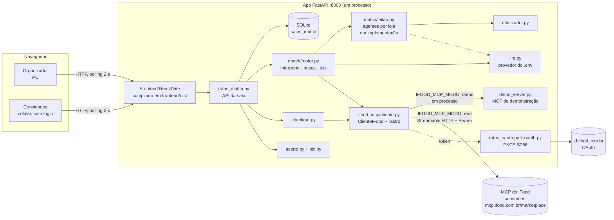
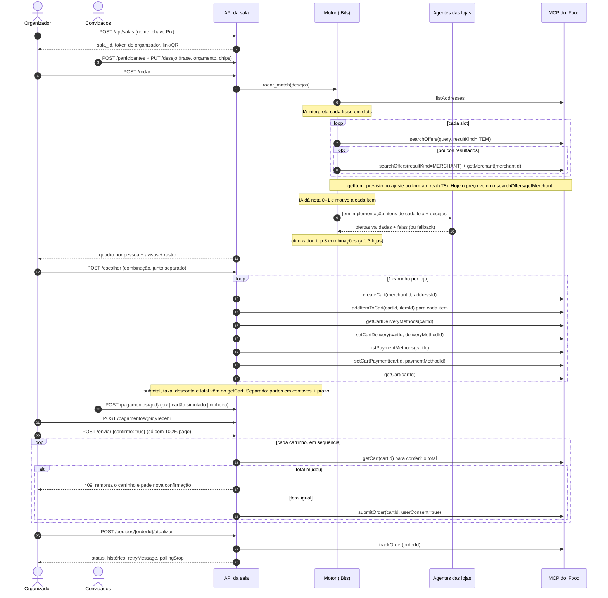
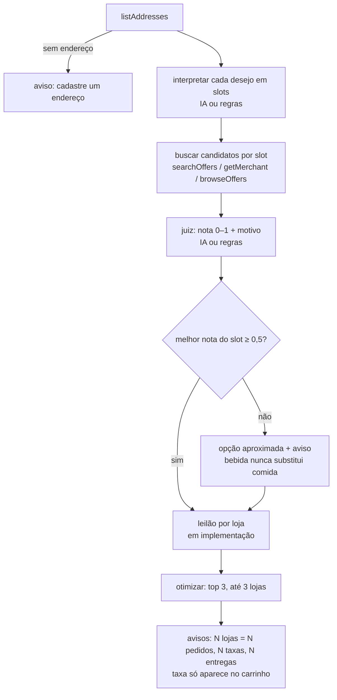
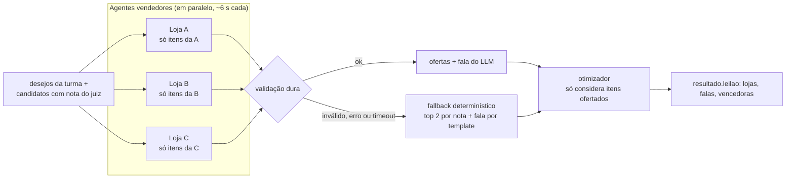
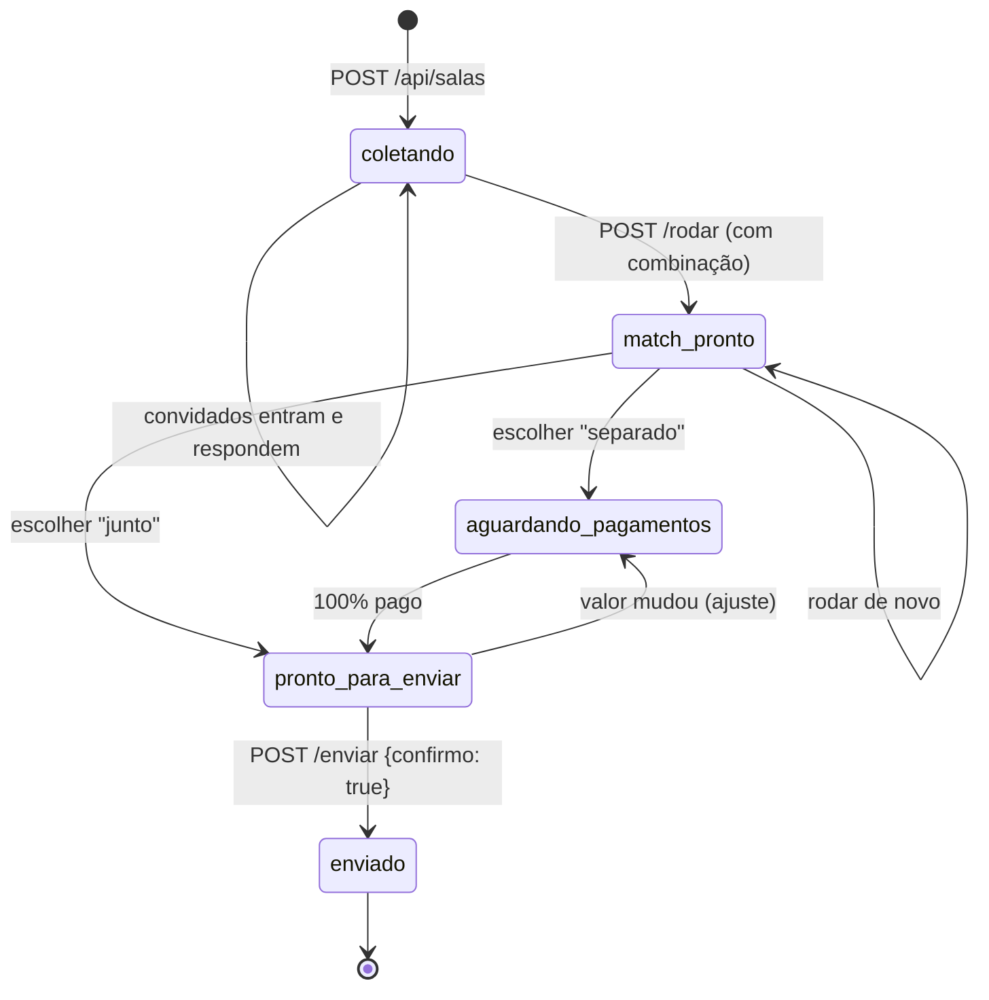

# Match — desenho de solução e documentação técnica

> Entregáveis 2 (desenho de solução) e 5 (documentação técnica) do Hackathon SEMCOMP 29 × iFood.
> Protótipo de hackathon, não afiliado ao iFood. Como rodar: [`README.md`](../README.md).
> Estado em 18/10/2026. O que ainda não está no código vem marcado **[em implementação nesta etapa]**.

## 1. Visão geral

O Match transforma frases livres de 1 ou N pessoas em um pedido viável no iFood: itens reais, preço real, loja(s)
real(is), custo total e motivo de cada escolha. Só o organizador entra no iFood; os convidados entram por link/QR,
sem login.

Divisão de trabalho entre IA e código (decisão central do projeto):

| Quem | Faz |
|---|---|
| IA (LLM, saída JSON) | entende a frase (slots, restrições, orçamento, perfil); dá nota 0–1 e motivo a cada item; **[em implementação]** fala e escolha de ofertas do agente de cada loja |
| Código determinístico | filtra restrições e orçamento; enumera e pontua combinações; divide a conta em centavos; gera o Pix; segue a ordem do checkout; exige consentimento |
| MCP do iFood | **única fonte** de preço, taxa, prazo, disponibilidade, carrinho e pedido |

Toda chamada de IA tem um caminho determinístico de reserva. Com `LLM_PROVIDER=mock` a demo inteira roda sem chave
e sem internet.

## 2. Componentes



| Componente | Arquivo | Papel |
|---|---|---|
| Frontend | `frontend/src/` | React 19 + TypeScript (Vite). Rotas por hash: `#/` (início estilo app), `#/s/{id}` (convidado), `#/s/{id}/org` (organizador), `#/conectado` (volta do login). Polling de 2 s em `GET /api/salas/{id}`. Compilado e servido pelo próprio FastAPI (uma URL na demo). |
| API da sala | `backend/app/rotas_match.py` | Criar sala, entrar, desejo, rodar, escolher, pagar, enviar, acompanhar. Ações do organizador exigem o header `X-Organizador`. |
| Sala | `backend/app/match/salas.py` | Estado inteiro da sala em JSON numa tabela SQLite própria. Escrita atômica (trava + transação). Chamadas ao MCP ficam fora da trava de gravação e o estado é revalidado depois. |
| Motor | `match/motor.py` | `listAddresses` → interpretar → buscar → julgar → otimizar → avisos. |
| Intérprete | `match/interprete.py` | Frase → 1 ou mais **slots** ("japonês e um sorvete" = 2 slots). IA com validação; reserva por palavras-chave + chips. |
| Busca | `match/busca.py` | Único arquivo que lê campos das tools de descoberta. Preço só da tool; item sem preço é descartado. ≤ 8 candidatos por slot, diversificados por loja. |
| Juiz | `match/juiz.py` | Nota 0–1 + motivo curto. Restrição sem tag no item não elimina: o motivo avisa "confirme com a loja". |
| Leilão | `match/leilao.py` | **[em implementação nesta etapa]** 1 agente vendedor por loja (seção 5). |
| Otimizador | `match/otimizador.py` | Código puro, sem I/O nem IA (seção 6). |
| Checkout | `match/checkout.py` | Único arquivo que lê campos de carrinho/pedido. 1 carrinho por loja, envio com consentimento, `trackOrder`. |
| Acerto e Pix | `match/acerto.py`, `match/pix.py` | Partes por pessoa em centavos; Pix copia e cola (BR Code estático). |
| Cliente MCP | `ifood_mcp/cliente.py` | Mesma interface nos dois modos; registra cada chamada no **rastro** (tool, resumo sem dados sensíveis, ms, ok/erro). |
| MCP de demonstração | `ifood_mcp/demo_server.py` | Servidor MCP (SDK `mcp` 2.x) com 17 tools de **mesmo nome e campos** da doc oficial; lojas fictícias; todo payload com `"demonstracao": true`. |
| OAuth | `ifood_mcp/oauth.py`, `rotas_oauth.py` | Authorization Code + PKCE S256 + client secret; tokens em arquivo fora do git; renovação automática. |
| Diagnóstico | `ifood_mcp/diagnostico.py` | Roda no PC da equipe: `list_tools` + chamadas de leitura → amostras **sanitizadas** em `docs/mcp-real/`. Nunca chama `submitOrder`. |

## 3. Sequência completa de um Match em grupo

Ordem obrigatória da documentação do MCP: `listAddresses` → `searchOffers` → `getMerchant` → `getItem` →
`createCart` → `addItemToCart` → `getCartDeliveryMethods` → `setCartDelivery` → `listPaymentMethods` →
`setCartPayment` → `getCart` → `submitOrder({cartId, userConsent: true})` → `trackOrder`.



Cada seta para o MCP vira uma linha do rastro na tela, com o nome da tool da documentação. O resumo do rastro não
mostra latitude, longitude, endereço, e-mail, telefone nem CPF.

## 4. Fluxo do motor (hoje)



Regras de relevância já no código: item com nota < 0,25 sai se houver opção melhor; slot cujo melhor item fica
abaixo de 0,5 vira "Opção aproximada: …" com aviso "Não achei X; a opção mais próxima é Y"; se ninguém tem item
relevante, não há combinação e a API devolve 409 com a pergunta "Quer mudar o pedido?".

## 5. Leilão de agentes por loja — [em implementação nesta etapa]

Contratos C11 e C12 de [`docs/planos/etapa-04-leilao-e-entrega.md`](planos/etapa-04-leilao-e-entrega.md).
Decisões 9 e 10 de [`docs/decisions.md`](decisions.md). **Nada desta seção está no código ainda** (o arquivo
`match/leilao.py` e as telas do leilão estão sendo escritos agora).

Ideia: o tema é "Vendendo com Agentes". Cada restaurante tem um **agente vendedor** que só enxerga o próprio
cardápio (vindo do MCP) e disputa o pedido; o **IBits**, agente comprador do grupo, decide entre os lances.



Como vai funcionar (planejado):
- Um agente por loja, em paralelo (`asyncio.gather`), com tempo máximo de ~6 s cada. Até 8 lojas no leilão.
- Entrada do agente: só os itens daquela loja por slot (nome, descrição, tags, preço do MCP, nota do juiz) e o texto
  de cada pessoa. Saída JSON: `{"ofertas": [{"slot_id", "item_id", "motivo"}], "passo": bool, "fala": str}`.
- **Validação dura:** `slot_id` existe; `item_id` é candidato daquela loja naquele slot; no máximo 2 ofertas por
  slot; motivo ≤ 90 caracteres; **todo número na fala** precisa estar no conjunto permitido (preços ofertados,
  ETA, avaliação, contagens, afinidade). Número fora do conjunto → fala trocada pelo template
  (`fonte_fala: "modelo"`). Oferta inválida é descartada.
- **Fallback** (modo `mock`, erro, timeout): top 2 por nota do juiz em cada slot da loja; fala por template a partir
  dos números.
- **Garantia:** com `LLM_PROVIDER=mock` o resultado do roteiro da demo não muda.
- **Patrocinado = só visibilidade:** a loja patrocinada tem o lance mostrado primeiro e o rótulo "Patrocinado";
  **nunca** muda nota, filtro ou escolha do otimizador. No demo, 1 loja patrocinada que não vence (mostra que pagar
  não compra o pedido). No modo real nenhuma loja é patrocinada. Configuração em `match/politica_lojas.json`.
- A taxa de entrega **não** aparece nas falas: ela só existe no carrinho.
- No front: tela "Leilão ao vivo" (falas tocadas em sequência, botão Pular) e depois um deck de até 3 combinações
  (deslizar ou botões equivalentes, "É um Match!"), para organizador e convidados.

## 6. Otimizador

Código puro em `match/otimizador.py`. A IA só fornece a nota de cada item e o perfil de cada pessoa.

```
S(C) = média_p(sat_p) + α·mín_p(sat_p) − β·(custo_total / orçamento_ref) − γ·(atraso_max / 60)
       − δ·(lojas − 1) − ε·penal_perecível − penal_slots_fora
```

- `sat_p` = média das notas dos slots escolhidos da pessoa `p` (0 se ela ficou de fora).
- **Justiça:** o termo `α·mín` puxa para cima quem ficou pior; ninguém fica com nota baixa para os outros ganharem.
- **Pesos por perfil** (`barato`, `rapido`, `qualidade`, `equilibrado`); com vários perfis no grupo, média campo a
  campo. Padrão: α 0,5 · β 0,3 · γ 0,2 · δ 0,15 · ε 0,3. "Barato" sobe β para 0,9; "rápido" sobe γ para 0,6.
- **Restrições duras:** item que viola restrição sai; o orçamento da pessoa vale para a **soma** dos slots dela.
- **Slots por pessoa:** o 2º item em diante é opcional (penalidade 0,35 se ficar de fora); o principal paga 1,0.
- **Até 3 lojas** (`MAX_LOJAS = 3` no motor). Se algo ficou de fora, o motor testa 4 lojas e avisa o que entraria
  ("+1 pedido, +1 taxa, +1 entrega"); a escolha continua com o organizador.
- **Perecível:** ε só se um sorvete/açaí de restaurante vier de loja com ETA diferente em mais de 15 min.
- **Enumeração exaustiva** por conjunto de lojas, com ≤ 8 candidatos por slot, poda acima de 50 mil combinações por
  conjunto e 120 mil no total. Desempate determinístico (score, depois custo, depois chave estável).
- Taxa de entrega: a busca não traz taxa; o otimizador roda "sem taxa" (`taxa_conhecida: false`) e a tela avisa que a
  taxa aparece no carrinho, antes do "ok".
- Cada combinação traz os componentes do score e uma explicação curta ("3 lojas · todos com nota ≥ 0,7 · R$ … sem
  taxa · chega em até … min").

## 7. Acerto em centavos e vaquinha

`match/acerto.py` (modo "separado"):
- Cada pessoa paga os próprios itens.
- A **taxa de entrega de uma loja é dividida igualmente entre quem pediu daquela loja**.
- Desconto de uma loja é proporcional ao valor dos itens de cada um nela.
- Tudo em centavos inteiros (`Decimal`, arredondamento meio para cima). A sobra vai pelo método do maior resto, então
  **a soma das partes é exatamente o total dos carrinhos**. Valores de entrada vêm do `getCart`.
- Prazo para todos pagarem: **10 min + 2 min por pessoa acima de 2**.

Formas de pagamento da vaquinha (o app nunca guarda nem movimenta dinheiro):
- **Pix:** `match/pix.py` gera o "copia e cola" estático do Banco Central (EMV): campos 00, 26 (`br.gov.bcb.pix` +
  chave), 52, 53 (986), 54 (valor), 58 (BR), 59 (nome ≤ 25), 60 (cidade ≤ 15), 62 (txid) e 63 (CRC16-CCITT-FALSE). A
  chave é normalizada (CPF/CNPJ só dígitos, telefone +55, e-mail minúsculo, aleatória intacta). O dinheiro vai direto
  para a chave do organizador; ele marca "recebi".
- **Cartão simulado:** só no modo `demo`, com selo. No modo real a API recusa (409).
- **Dinheiro:** o organizador marca "recebi".
- Pendências: o organizador pode cobrir a parte de alguém ou remover os itens dessa pessoa (recalcula carrinho e
  partes).

No modo "junto" não há partes: a sala vai direto para "pronto para enviar".

## 8. Máquina de estados da sala



Regras: rodar sem nenhuma combinação devolve 409 e a sala fica em `coletando`. Transição fora da tabela é recusada.
Máximo de 6 participantes (limite do otimizador). Envio parcial (falha no 2º pedido) guarda os já enviados em
`ja_enviados` e nunca os reenvia; tentar de novo continua de onde parou.

## 9. Segurança e confiança

- **Consentimento:** `submitOrder` só é chamado por `checkout.enviar_pedidos(..., consentimento=True)`, que a API
  só passa com `{"confirmo": true}` do organizador (token no header), no estado `pronto_para_enviar` (100% pago no
  modo separado). O servidor de demonstração também recusa `submitOrder` sem `userConsent: true`.
- **Preço só de tool:** preço, taxa, prazo e disponibilidade vêm da resposta do MCP. Antes de cada envio o `getCart`
  é chamado de novo; se o total mudou, nada é enviado, o carrinho é remontado e o organizador confirma de novo.
  Preço de item diferente entre a busca e o carrinho gera aviso.
- **IA sem números:** o LLM interpreta e dá nota; a conta é código. **[em implementação]** no leilão, fala com número
  fora do lance é descartada.
- **Tokens e segredos fora do git:** client id/secret só no `.env`; tokens em `backend/.tokens_ifood.json` (ambos no
  `.gitignore`), gravados com troca atômica. Segredos com `repr=False` na configuração. Token, refresh, secret e
  code nunca vão para log, exceção nem resposta HTTP. Os testes zeram as credenciais e isolam o arquivo de tokens.
- **OAuth:** PKCE S256, `state` válido por 10 min, `resource=` (RFC 8707). Erros de login viram 401 com mensagem
  legível.
- **Sanitização:** o diagnóstico mascara nome, e-mail, telefone, CPF, meios de pagamento, endereço textual
  (coordenadas arredondadas) e qualquer campo com "token" antes de gravar; erro sem traceback cru. O rastro omite
  localização e dados pessoais. O `GET` da sala não devolve o token do organizador, a chave Pix inteira (só
  mascarada), o texto do desejo dos outros nem o endereço completo.
- **Nunca pagar teste:** o Pix de um pedido da conta de teste não tem reembolso. O diagnóstico nunca chama
  `submitOrder`. Por regra da equipe, a demo real para no `getCart` enquanto não houver uma forma de pagamento da
  conta de teste que não cobre (pergunta em aberto no plano da etapa 03).
- **Selo:** todo dado simulado aparece com o selo DEMONSTRAÇÃO; no modo real, "iFood real · conta de teste".

## 10. Uso correto do MCP

| O que a documentação pede | Como cumprimos |
|---|---|
| `listAddresses` primeiro | O motor chama `listAddresses` antes de qualquer busca; sem endereço, para com aviso. |
| `query` só descritivo; preço/distância em `refinements` | A busca manda o termo descritivo ("sushi", "sorvete"), `resultKind`, `limit` e as coordenadas do endereço; orçamento e restrições são filtrados no nosso código, não na `query`. |
| 1 carrinho = 1 restaurante + 1 endereço | `checkout.py` agrupa a combinação por loja e monta 1 carrinho por loja. |
| `createCart` não é idempotente | Uma trava por sala serializa as ações do organizador que falam com o MCP; a máquina de estados só aceita "escolher" em `match_pronto`, então clique duplo não cria carrinho em dobro. |
| Não confundir `itemId`, `cartItemId`, `cartId` | O checkout guarda o dono de cada `cartItemId` e confere o `getCart` contra o que foi adicionado. |
| Método de entrega e pagamento vêm das tools | Usa o `recommendedMethodId` de `agentHints` se estiver na lista; senão o 1º. Pagamento: o id pedido, senão o 1º crédito, senão o 1º (com aviso). Nunca inventa id. |
| `getCart` para conferir o total | Valores da tela vêm do `getCart`; ele é chamado de novo antes de cada `submitOrder`. |
| `submitOrder` com `userConsent: true` só após confirmação humana | Seção 9. |
| `trackOrder`: seguir `agentHints.retryMessage` e parar em `pollingStop` | `checkout.acompanhar` devolve `proxima_consulta` (retryMessage) e `encerrado` (pollingStop). A consulta é sob demanda (botão "Atualizar"), sem polling automático. |
| Nomes das tools | O demo usa os nomes da doc; o diagnóstico grava o `list_tools` real para confirmar. Diferenças entre doc e real vão para [`docs/feedback-mcp.md`](feedback-mcp.md). |

Formato real das respostas: só `busca.py` e `checkout.py` leem campos das tools. Ajustar ao MCP real é mexer só
neles **[em implementação nesta etapa: tarefa T8, a partir das amostras do diagnóstico]**.

## 11. Limites conhecidos e próximos passos

Limites hoje:
- Leilão de agentes, telas do leilão/deck e visual final do app: **em implementação nesta etapa**.
- Busca e checkout seguem o formato da documentação; o ajuste ao formato real depende das amostras do diagnóstico
  rodado no PC da equipe. `getItem` (opções e preço promocional) ainda não é chamado pelo motor.
- No modo real, o código permite `submitOrder` depois da confirmação; a regra de parar no `getCart` é da equipe, não
  uma trava no código.
- Não há tool de cancelamento no MCP: se o 2º pedido falhar depois do 1º enviado, o 1º fica. O app envia em
  sequência, para no 1º problema e mostra o que saiu.
- O MCP não junta pedidos de lojas diferentes: N lojas = N pedidos, N taxas, N entregas (o app avisa antes).
- Vouchers (`listVouchers`/`setVoucher`), `scheduledTime` e endereço novo (`createAddress`) não são usados.
- Até 6 pessoas por sala; o login OAuth só volta para o `localhost` do PC que roda o app.

Próximos passos:
- Terminar o leilão (C11–C13) e o ajuste ao formato real; rodar o Match real até o `getCart` com taxa real.
- Ajustar prompts com IA real e medir o tempo do leilão (meta ≤ 8 s).
- Depois do hackathon: `getItem` para opções do item, vouchers por loja, `scheduledTime` para alinhar perecíveis,
  memória do grupo e histórico (`getRecommendations`).

## 12. Testes

- **176 testes** no backend (pytest), todos passando em 18/10/2026:
  `cd backend && .venv/bin/python -m pytest -q`. Typecheck do frontend: `cd frontend && npm run typecheck`.
  Tudo junto: `./iniciar.sh --testes` (Windows: `iniciar.ps1 -Testes`).
- O que cobrem (arquivos em `backend/tests/`):
  - `test_ifood_mcp.py`: a sequência obrigatória inteira via cliente MCP; `submitOrder` sem consentimento falha;
    rastro de cada tool.
  - `test_otimizador.py`, `test_acerto_pix.py`: restrição elimina; justiça; perfil muda o vencedor; partes somam o
    total ao centavo; prazo; CRC e campos do Pix; normalização da chave.
  - `test_motor.py`: roteiro da demo com `LLM_PROVIDER=mock` trava o top 1; caminho com LLM falso; opção aproximada.
  - `test_checkout.py`: sem consentimento não envia; total mudou para; falha no 2º pedido mantém o 1º.
  - `test_salas.py`: fluxo inteiro da API; sem token → 403; enviar antes de 100% pago → 409.
  - `test_oauth.py`, `test_diagnostico.py`: PKCE S256, `state` inválido, troca e renovação, token nunca em resposta
    ou log, 401 → renova 1 vez; sanitização com payloads cheios de dados pessoais.
  - `test_endereco_localizacao.py`: endereço em formatos variados, `userLocation` pelo `input_schema`, `submitOrder` real travado.
  - `test_saude.py`: `/api/saude` com `ip_local` para o QR.
- **[em implementação nesta etapa]** `test_leilao.py`: fala com número inventado cai no template; item de outra loja
  é rejeitado; patrocinado não muda a escolha; roteiro mock inalterado; tempo limite respeitado.
